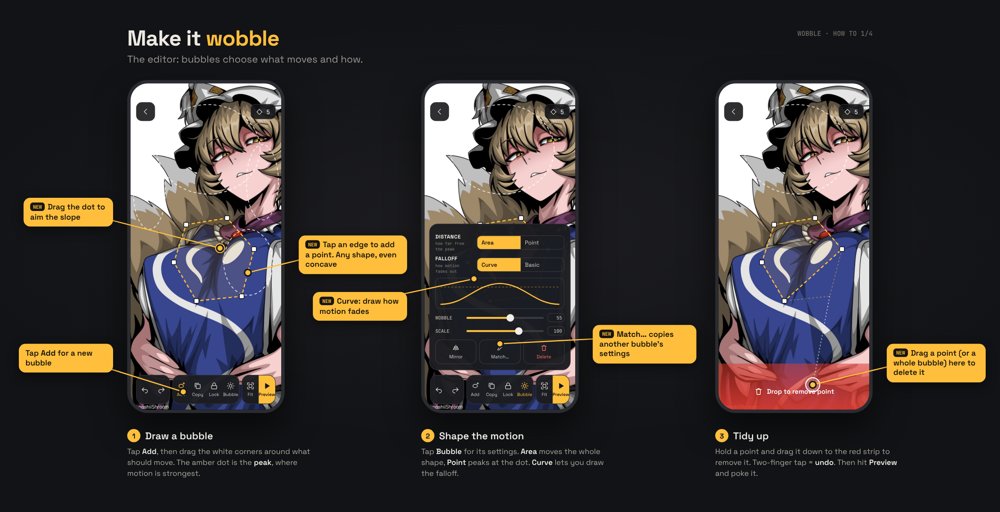
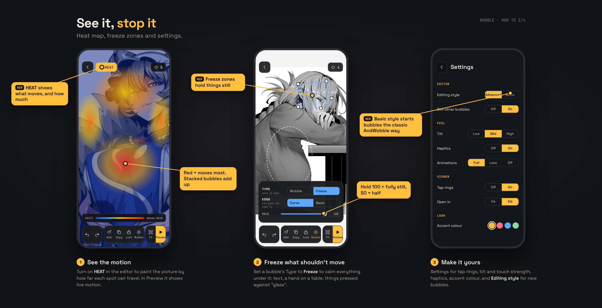
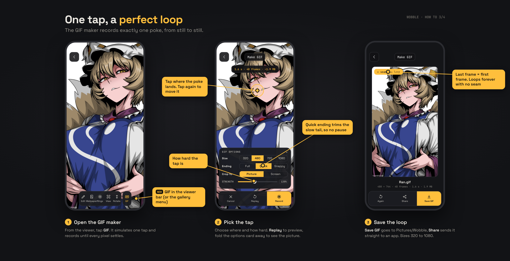
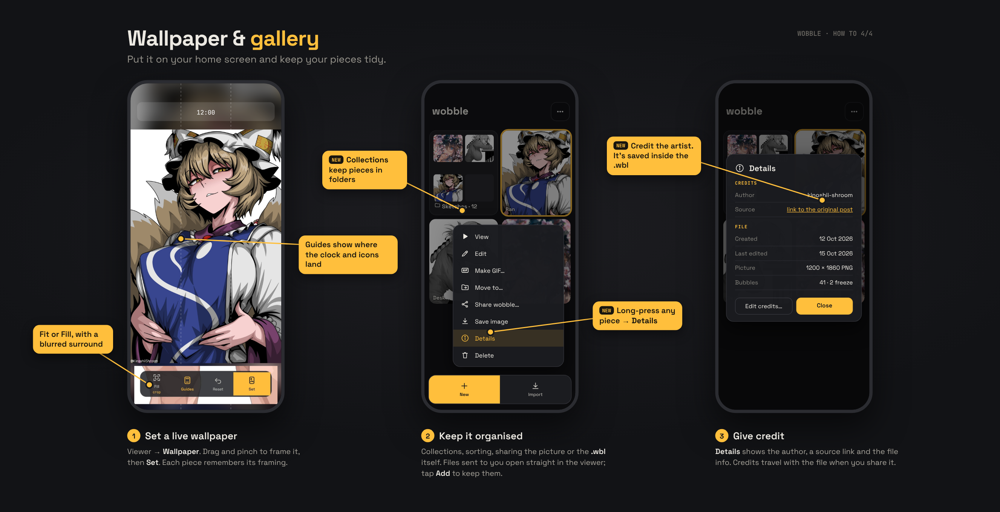

# Wobble

A free, open-source revival of **AndWobble2**, the discontinued Android app that makes parts of a picture wobble when you touch or tilt your phone.

Draw shapes ("bubbles") over a picture to choose what jiggles and how. Then poke it, set it as a live wallpaper, or record a looping GIF. Wobble opens original `.wbl` files, and the files it saves still open in the old app.

> Made with Claude. The code was written by Claude (Anthropic's AI). The design, direction, art and testing were done by me, [@twigglebiggle](https://github.com/twigglebiggle). AndWobble was abandoned, and it had a small, lovely community of creators. This is my attempt to give it a second life.

---

## How to

## Features

**Viewer and wallpaper**
- Live wallpaper for the home and lock screen. A framing screen lets you set the crop, show guides, pick Fit or Fill and choose the surround (black, graphite, blurred art or a colour).
- Reacts to touch and tilt. Pinch to zoom up to 6×. Works in landscape.
- Open `.wbl` files from any app to view them without importing. Tap **Add** to keep one.

**Editor**
- Bubbles can have any number of points and can be concave.
- **Area** or **Point** distance. In Area mode, moving the peak tilts the slope towards it.
- **Curve** falloff: draw your own motion profile, with Scale and a Ceiling cap. **Basic** is the classic falloff.
- **Freeze zones**: hold parts of the picture still, or partly still. Good for text, or for things pressed against "glass".
- **Heat map**: see what moves and how much, while you edit and live in Preview.
- Undo and redo (two-finger tap undoes). Lock bubbles. Copy a bubble. **Match…** copies one bubble's settings onto another.
- Drag a point or a bubble to the bin at the bottom to delete it.
- Bubble list and custom outline styles.

**GIF maker**
- One tap gives a perfect loop. It records from the still picture until the last pixel settles, so the loop has no seam.
- Pick where to tap and how hard. Sizes 320–1080, 25–50 fps.
- Endings: Full, Quick or Snappy. Crop to the picture or to the screen.
- Uses its own small GIF encoder, with a stable palette and dithering, so there's no flicker.

**Gallery**
- Collections (folders), sorting, and 2 or 3 columns.
- Share the picture or the `.wbl` file, or save the original image.
- **Credits** stored in the file: author (or an AI tag) and a source link. **Details** shows those plus the created date, size and bubble count.

**Settings**
- Tap rings, tilt and touch strength, haptics, animation level and accent colour.
- Editing style: Advanced (Area + Curve) or Basic (Point + Basic) for new bubbles.

## Compatibility

- Android 8.0+ (API 26). Tested mainly on a Samsung S23 FE.
- Reads and writes AndWobble `.wbl` files: a PNG or JPEG with the wobble data embedded.
- New data (curves, freeze zones, credits) goes in extra fields that the original app ignores. Freeze zones show up there as bubbles that don't move.
- Fully offline. No accounts, no servers, no ads, no tracking.

## Building

1. Clone the repo and open it in **Android Studio**.
2. Let Gradle sync. It needs JDK 17. There are no third-party libraries.
3. Run on a device. An emulator works, but tilt needs a real phone.

## Credits

- **AndWobble / AndWobble2**: the original app and the `.wbl` format. All credit for the idea goes to its creators. This project is an unofficial fan rebuild and is not affiliated with them.
- Built by [@twigglebiggle](https://github.com/twigglebiggle). Code by Claude.
- Art in the screenshots: Ran by **kinoshii-shroom**, plus pieces by _TBD_ (desk drawing) and _TBD_ (cherry blossoms). All art belongs to its artists and is shown only to demo the app.

## License

_TBD_
